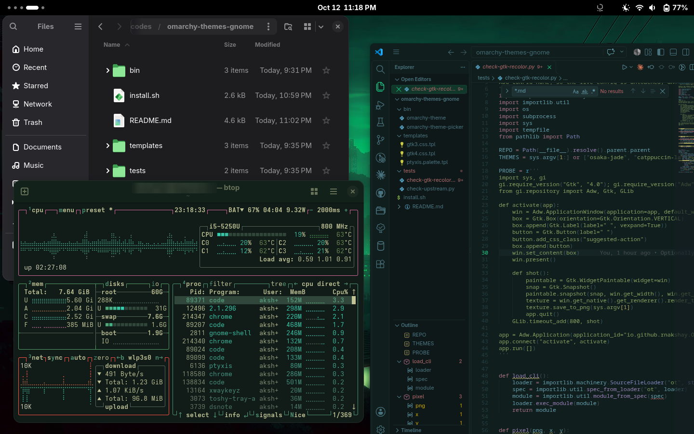
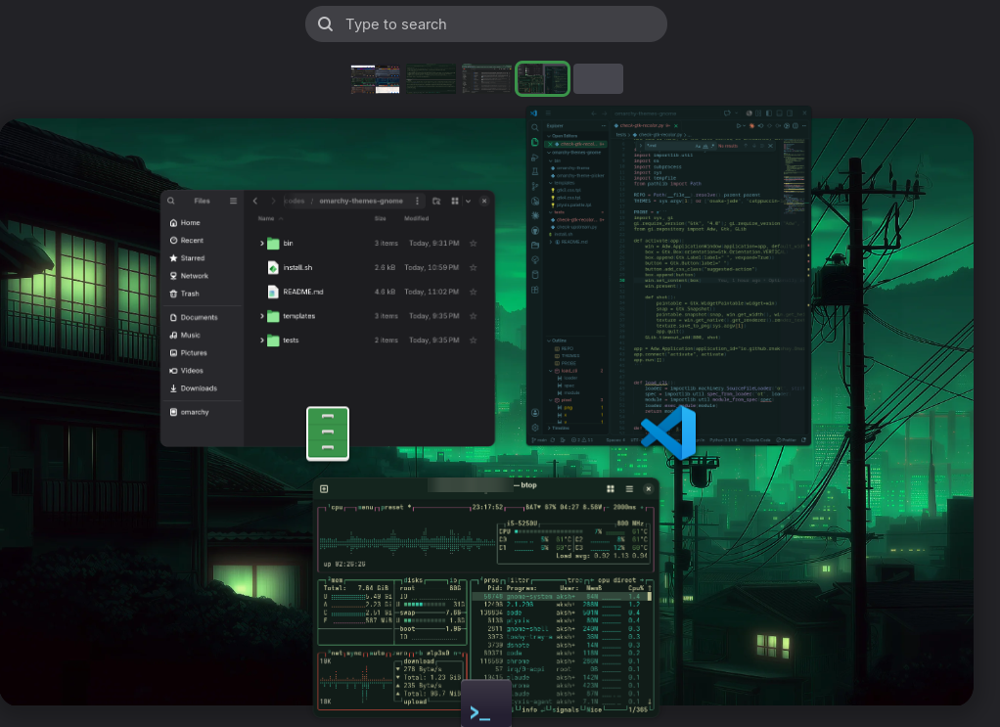
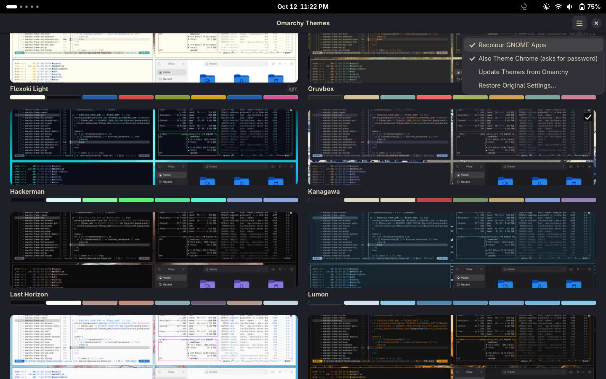
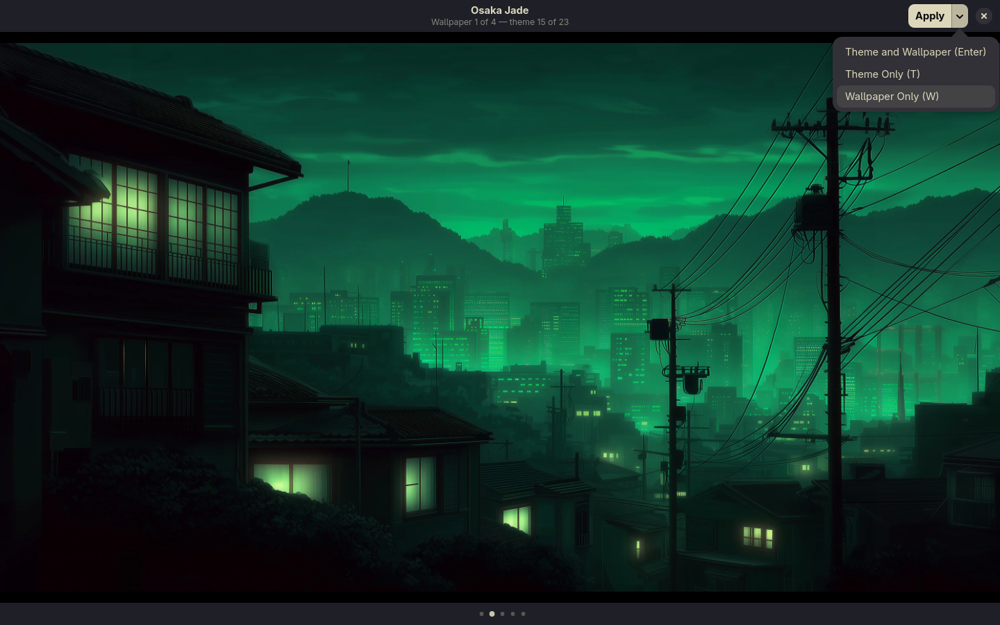

# Omarchy Themes for GNOME

Use [Omarchy](https://github.com/omacom/omarchy)'s themes on a regular GNOME desktop: one click
recolours GNOME, your terminal, VS Code and btop, and sets a matching wallpaper.
Unofficial — not affiliated with Omarchy or Basecamp.



*Osaka Jade on stock GNOME: Files (with accent-coloured folders), Ptyxis running btop, and VS Code.
Windows, top bar and layout stay GNOME's — it changes colours and wallpaper, not how GNOME works.*



## The app



Open **Omarchy Themes** from Activities. Every Omarchy theme is shown as a card with its preview
and colour palette; the current one has a check mark.

Click a card to **preview it full screen** — Omarchy's screenshot of the theme first, then each
of its wallpapers:

| Key | |
|---|---|
| ← / → (or swipe) | previous / next picture of this theme |
| ↑ / ↓ | previous / next theme |
| Enter | apply the theme and the wallpaper on screen |
| T | apply the theme only — keeps your wallpaper, including your own from GNOME Settings |
| W | apply the wallpaper only — keeps the current colours |
| Esc | close without changing anything |



The same three choices are on the **Apply ▾** button. Mixing is easy: find a wallpaper you like
in any theme and press W, then find the colours you want and press T.

The **☰ menu** chooses what a theme switch changes, besides GNOME's dark/light mode, accent and
wallpaper. Apps that aren't installed aren't listed.

| Option | Default | |
|---|---|---|
| GNOME App Colours | off | windows, sidebars and headers in the theme's colours, not just the accent (see *Design*); apps pick it up when reopened |
| Coloured Folders | off | folder icons in the accent colour; ticking it downloads and builds the icons and starts a small service that follows the accent, unticking removes both |
| Terminal (Ptyxis) | on | |
| VS Code | on | |
| btop | on | |
| Chrome | off | toolbar colour; asks for an admin password on each switch |

Below them: **Update Themes from Omarchy** and **Restore Original Settings…** (everything back as
it was before the first theme).

## What a theme changes

| | |
|---|---|
| GNOME | dark/light mode, nearest accent colour |
| Folder icons | *option*: Adwaita recoloured to the accent ([Adwaita-colors](https://github.com/dpejoh/Adwaita-colors)), also when the accent is changed by hand |
| GNOME apps | *option*: window, sidebar, header and exact accent colours |
| Wallpaper | one of the theme's own backgrounds, chosen in the preview |
| Ptyxis | a generated terminal palette |
| VS Code | the theme's named VS Code theme, or one generated from its colours |
| btop | Omarchy's btop template |
| Chrome / Chromium | *option*: toolbar colour via browser policy |

## Install

```bash
git clone https://github.com/rnakshay/omarchy-themes-gnome
cd omarchy-themes-gnome
./install.sh              # the app in Activities, omarchy-theme on PATH
./install.sh --uninstall
```

Nothing needs root, and nothing keeps running unless you tick *Coloured Folders*. With it on,
untick and tick it again after a GNOME update, so the icons are rebuilt from the new Adwaita.

Requires Python 3.11+, git, PyGObject with GTK 4 / libadwaita 1.6+; `dwebp` (libwebp-tools) and
glycin's GObject bindings are recommended for `.webp` wallpapers. `install.sh` checks and names the
packages to install on Fedora, Debian/Ubuntu and Arch. Made and tested on Fedora 44, GNOME 50.

## Command line

Everything the app does is the `omarchy-theme` command underneath, for scripts and terminals:

```bash
omarchy-theme list                      # * marks the current theme
omarchy-theme set osaka-jade [--skip chrome,vscode,wallpaper] [--wallpaper 2]
omarchy-theme wallpaper tokyo-night 2   # another theme's wallpaper, current colours kept
omarchy-theme next-wallpaper            # cycle the current theme's wallpapers
omarchy-theme colors tokyo-night        # preview a palette in the terminal
omarchy-theme options                   # which options are on
omarchy-theme enable|disable vscode     # options: apps folders ptyxis vscode btop chrome
omarchy-theme sync                      # pull new and updated themes from Omarchy
omarchy-theme reset                     # restore everything from before the first theme
```

## Known rough edges

- **Open GNOME apps keep their old colours** until reopened when *GNOME App Colours* is on —
  GTK only reads its style file at start.
- **The top bar and Activities overview** only take the accent colour, not the full palette;
  recolouring them needs a GNOME Shell theme, which this deliberately avoids.
- **Layout stays GNOME's.** Omarchy's preview screenshots are its Hyprland desktop (tiled windows,
  its own bar); here you get the colours and wallpaper, not that layout.
- **Accent colour is the nearest of GNOME's nine**, unless *GNOME App Colours* is on, which uses
  the theme's exact accent inside apps.
- **Chrome asks for an admin password on every switch** — the toolbar colour is set through a
  browser policy file under `/etc`. Off by default for that reason.
- **Restore Original Settings** goes back to how things were before the first theme was applied
  (or before the first one after the last restore); changes you made by hand in between, such
  as picking your own wallpaper, aren't remembered.
- **Neovim isn't themed** yet: Omarchy's Neovim themes assume a LazyVim setup.

## Design: stay small, survive updates

- **An app, not a Shell extension.** Nothing runs inside GNOME Shell, so GNOME releases don't
  break it. The app only calls `omarchy-theme`, which does the work.
- **Supported interfaces by default**: gsettings, Ptyxis palette files, VS Code settings, btop
  themes, Chrome enterprise policy. No GNOME Shell themes.
- **The one unsupported piece is opt-in.** App recolour uses libadwaita's documented CSS
  variables via `gtk.css`, which GNOME doesn't promise to keep honouring.
  `tests/check-gtk-recolor.py` renders a real libadwaita window and checks the pixels, so a
  GNOME update that breaks it shows up as a failing test. Turning it off removes it entirely.
- **Themes are not copied.** They are read from a sparse clone of Omarchy, and Omarchy's own
  templates are reused, so upstream fixes arrive with an update.
- `tests/check-upstream.py` checks the colour resolver still matches Omarchy's
  `omarchy-theme-color` for every theme, and that every template renders. Run it after an update.

## License

MIT. Themes, templates and wallpapers come from Omarchy (MIT) and are fetched, not bundled.
